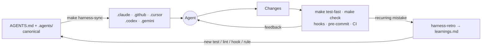

# ai-harness-template

[](https://github.com/Lucas-Mol/ai-harness-template/actions/workflows/ci.yml)

A **tool-agnostic, stack-agnostic repository template** for AI-assisted development with good
*harness engineering*: context, constraints, tools, feedback loops, verification and protection against entropy.

Write your agent rules **once** — in [`AGENTS.md`](AGENTS.md) and [`.agents/`](.agents/) — and generate
adapters for Claude Code, GitHub Copilot, Cursor, Codex and Gemini CLI.



## What you get

| Area | Contents |
|---|---|
| Agent contract | [`AGENTS.md`](AGENTS.md) (short map, < 150 lines), [`CLAUDE.md`](CLAUDE.md) imports it |
| Skills | `create-plan`, `execute-plan`, `write-adr`, `code-review`, `debug-failing-check`, `harness-retro` ([`.agents/skills/`](.agents/skills/)) |
| Subagents | `planner`, `implementer`, `reviewer`, `security-reviewer` ([`.agents/agents/`](.agents/agents/)) |
| Commands | `/plan`, `/implement`, `/review`, `/handoff` ([`.agents/commands/`](.agents/commands/)) |
| Command interface | [`Makefile`](Makefile): `setup fmt lint typecheck test test-fast build check eval` + `harness-*` |
| Guardrails | hooks ([`scripts/hooks/`](scripts/hooks/)): protected paths, generated-file protection, formatting, secret scan, checks on stop; tool permissions; CODEOWNERS |
| Feedback loops | `make harness-lint` (sizes, links, frontmatter, sync drift, plans), pre-commit, [CI](.github/workflows/ci.yml) |
| Entropy control | `make harness-gc` + [weekly workflow](.github/workflows/harness-gc.yml) opening an issue; [ratchet log](docs/harness/learnings.md) |
| Knowledge | [`docs/`](docs/): architecture, ADRs, plan/spec templates, conventions, glossary |
| Runtime LLM (optional) | `ai/`: provider port, versioned prompts, evals |

## Quick start

1. Click **Use this template** on GitHub (or clone) and enter the new repository.
2. Install the harness dependency (Python 3.10+): `make harness-deps`
3. Bootstrap: `make harness-init` — asks for name, description, owner, stack (`java | python | node | go | none`)
   and target tools, installs `stack.mk`, regenerates adapters. Non-interactive:
   ```bash
   make harness-init ARGS="--name billing --description 'Billing service' --owner @acme/core \
     --stack python --targets claude,copilot --remove-ai --yes"
   ```
4. Add your toolchain setup to [`.github/workflows/ci.yml`](.github/workflows/ci.yml).
5. Verify: `make harness-lint && make check`
6. Optional: `pipx install pre-commit && pre-commit install`
7. Enable branch protection on `main` with *Require review from Code Owners*.

## Daily use

| You want to… | Do |
|---|---|
| Change agent rules, skills, agents or commands | Edit `AGENTS.md` / `.agents/`, then `make harness-sync` |
| Plan a feature | `/plan <task>` (or ask the agent to use the `create-plan` skill) |
| Implement it | `/implement docs/plans/active/NNNN-….md` |
| Review | `/review` — or the `reviewer` / `security-reviewer` subagents |
| Pause and resume later | `/handoff` |
| Agent repeated a mistake | Ask it to run the `harness-retro` skill |
| Add a tool or remove one | Edit `targets` in `harness.config.yaml`, `make harness-sync` (orphans: `ARGS=--prune`) |

## Supported tools

| | Claude Code | Copilot | Cursor | Codex | Gemini CLI |
|---|---|---|---|---|---|
| Instructions | ✅ | ✅ | ✅ | ✅ | ✅ |
| Skills | ✅ | ✅ | ✅ | ✅ | ✅ |
| Subagents | ✅ | ✅ | — | — | — |
| Commands | ✅ | ✅ | ✅ | — | ✅ |
| Hooks & permissions | ✅ | — | — | — | — |
| MCP | ✅ | — | ✅ | ✅ | ✅ |

Details and caveats: [docs/harness/adapters.md](docs/harness/adapters.md). Tools without hooks still get
the same guardrails through pre-commit, CI and CODEOWNERS.

## Repository layout

```
AGENTS.md  CLAUDE.md  Makefile  harness.config.yaml
.agents/            canonical skills, agents, commands, MCP servers (+ .generated.json manifest)
.claude/ .cursor/ .codex/ .gemini/ .mcp.json  .github/{copilot-instructions.md,agents,prompts,skills}
                    GENERATED adapters — do not edit
.github/            CI, GC workflow, PR template, CODEOWNERS
scripts/harness/    sync · lint · gc · init (Python 3 + PyYAML)
scripts/hooks/      protect-paths · format-changed · check-on-stop · scan-secrets (+ wrappers/)
docs/               architecture · adr · plans · specs · conventions · harness · glossary
ai/                 optional runtime LLM module
examples/           stack.mk for Java, Python, Node, Go
```

## Why harness engineering

Models are capable; most failures come from the environment around them — missing context, no way to verify,
rules that exist only as prose. This template applies a few principles
(see [docs/harness/how-it-works.md](docs/harness/how-it-works.md)):

- **Single source of truth** — canonical files, generated adapters ([ADR-0001](docs/adr/0001-adopt-agents-md-as-source-of-truth.md)).
- **Progressive disclosure** — a short `AGENTS.md` map; details on demand.
- **Backpressure** — the agent validates its own work with deterministic commands.
- **Deterministic guardrails** — rules that matter are enforced by hooks, lint and CI.
- **Ratchet** — every recurring mistake becomes a permanent check.
- **Garbage collection** — stale plans, orphan docs and old TODOs are surfaced weekly.

References:
[AGENTS.md](https://agents.md) ·
[Agent Skills](https://agentskills.io) ·
[Awesome Harness Engineering](https://github.com/walkinglabs/awesome-harness-engineering) ·
[The Emerging "Harness Engineering" Playbook](https://www.ignorance.ai/p/the-emerging-harness-engineering) ·
[Claude Code best practices](https://www.anthropic.com/engineering/claude-code-best-practices) ·
[Effective context engineering for AI agents](https://www.anthropic.com/engineering/effective-context-engineering-for-ai-agents)

## Publishing this template

After pushing to GitHub: **Settings → General → Template repository** (manual step). Projects created from
this template should replace `Lucas-Mol/ai-harness-template` in the CI badge above with their own `OWNER/REPO`.

## License

[MIT](LICENSE)
