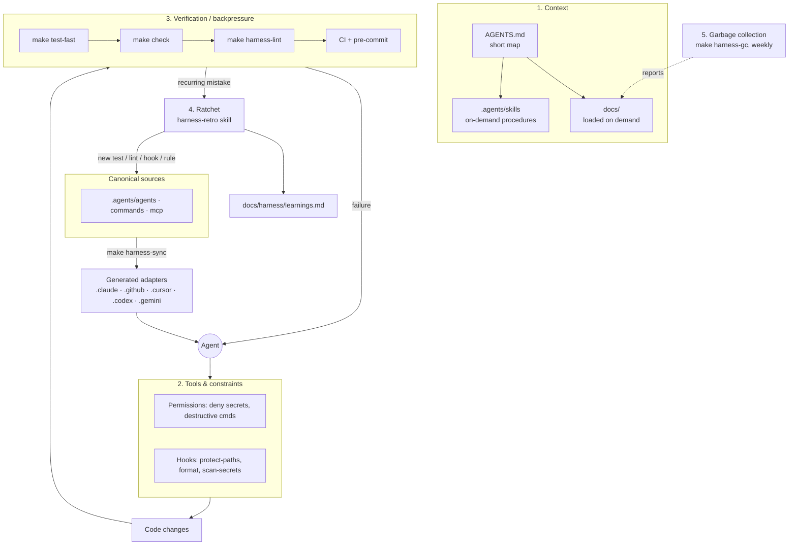

# How the harness works

An agent is only as good as its harness: the context it reads, the tools it may use, the checks that push back
on bad work, and the process that turns mistakes into permanent improvements.



## 1. Context — progressive disclosure

- [`AGENTS.md`](../../AGENTS.md) is loaded in every session, so it stays under `limits.agents_md_max_lines`. It is an index.
- Details live in `docs/` and skills; the agent opens them when relevant.
- Plans in `docs/plans/` carry state between sessions (the *Handoff* section).

## 2. Tools and constraints — guardrails in code

Rules that matter are enforced deterministically, not just written down:

| Guardrail | Mechanism |
|---|---|
| Don't touch CI, lock files, `.env*`, the harness config | `scripts/hooks/protect-paths.sh` (PreToolUse hook) + CODEOWNERS |
| Don't hand-edit generated adapters | `protect-paths.sh` + `sync --check` in `harness-lint` |
| Don't read secrets / run destructive commands | Tool permissions generated from `secret_files` / `deny_commands` |
| No secrets in the repo | `scan-secrets.sh` on every agent edit, in pre-commit and in CI |
| Consistent formatting | `format-changed.sh` after each edit |

Hook logic is plain shell that receives file paths as arguments. Thin per-tool wrappers
(e.g. [`scripts/hooks/wrappers/claude.py`](../../scripts/hooks/wrappers/claude.py)) translate each tool's
hook payload into those arguments, so the same logic serves agents, git hooks and CI.

## 3. Verification — backpressure

The agent validates its own work with the stack-agnostic `Makefile`:
`make test-fast` between edits, `make check` before finishing. The Stop hook (`check-on-stop.sh`)
runs fast checks when the agent tries to finish and sends failures back to it.

## 4. Ratchet

When the agent repeats a mistake, the [`harness-retro`](../../.agents/skills/harness-retro/SKILL.md) skill
proposes the most deterministic countermeasure available — **test/lint > hook > permission > text in AGENTS.md** —
and records it in [learnings.md](learnings.md).

## 5. Garbage collection

`make harness-gc` (and the weekly [`harness-gc.yml`](../../.github/workflows/harness-gc.yml) workflow) reports
stale plans, docs nobody links to, old TODOs and context files approaching their size limit. It never deletes.

## Source of truth and sync

See [ADR-0001](../adr/0001-adopt-agents-md-as-source-of-truth.md) and [adapters.md](adapters.md).

```
AGENTS.md, .agents/**, harness.config.yaml
        │  make harness-sync  (idempotent; --check for CI; --prune for orphans)
        ▼
.claude/  .github/{copilot-instructions.md,agents,prompts,skills}  .cursor/  .codex/  .gemini/  .mcp.json
        + .agents/.generated.json (manifest)
```
